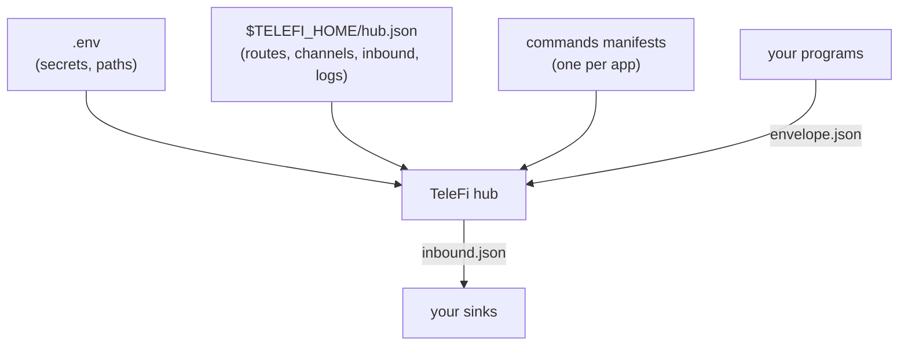

# Configuration reference



Every file below has a working template in [`examples/`](../examples) that the test suite validates
against its schema. Real configs and runtime records are git-ignored.

## Environment (`examples/.env.example`)

| variable | default | meaning |
|---|---|---|
| `TELEGRAM_BOT_TOKEN` | none | bot token from @BotFather (required for Telegram) |
| `TELEGRAM_CHAT_ID` | none | the only chat TeleFi talks to; others are ignored (required for Telegram) |
| `TELEFI_HOME` | `~/.telefi` | config, records and (by default) the spool |
| `TELEFI_SPOOL` | `$TELEFI_HOME/spool` | drop folder; overrides `spool` in `hub.json` |
| `TELEFI_LIVE` | `0` | `1` runs the live Telegram test in `pytest` |

## Hub config: `$TELEFI_HOME/hub.json` (schema `hub_config.v1`)

Templates: `examples/hub.minimal.json` (send-only) and `examples/hub.example.json` (replies and sinks), `examples/hub.batch.json` (batches and quiet hours).
Relative paths are relative to `TELEFI_HOME`. Without a `hub.json`, TeleFi uses built-in defaults:
errors, blockers, reviews and results go to Telegram, everything else to `bell.jsonl`; replies off.

| key | default | meaning |
|---|---|---|
| `mode` | `live` | `mock` swaps every channel for the mock (records, never sends) |
| `spool` | `spool` | drop folder |
| `dedup_window_min` | `360` | a `dedup_key` is delivered once per window (an envelope may override) |
| `logs.max_bytes` | `10485760` | a record file counts as full at this size |
| `logs.rotate_at` | `0.9` | rotate at this fraction of `max_bytes` (the safety margin) |
| `logs.keep` | `3` | rotated files kept (`name.1` ... `name.N`) |
| `channels.<name>.type` | | `telegram`, `file` or `mock` |
| `channels.<name>.token_env` / `chat_env` | `TELEGRAM_BOT_TOKEN` / `TELEGRAM_CHAT_ID` | which env vars hold the Telegram credentials |
| `channels.<name>.path` | | file channel output |
| `routes[]` | | first match wins: `match` on `source` / `kind` / `severity` lists; `{}` matches all; optional `delivery`: `now` / `batch` |
| `inbound.enabled` | `false` | read replies (one hub per bot: Telegram allows one reader) |
| `inbound.channel` | `telegram` | which channel's replies to read |
| `inbound.ack_days` | `7` | an acknowledged alert stays silent this long |
| `inbound.manifests[]` | `[]` | command manifests (below); they drive `/help`, `/list` and the `/` menu |
| `inbound.commands` | `{}` | extra bare commands: word -> namespace (prefer manifests) |
| `inbound.sinks.<ns>` | `*`: queue | where a namespace's events go: `{"type":"queue"}` or `{"type":"command","argv":[...],"cwd":"...","timeout_s":60}` |

## Command manifest (schema `commands.v1`), one per app

Template: `examples/commands.example.json`. Commands are `/<app> <verb> [args]`.

| key | meaning |
|---|---|
| `app` | the command word (`[a-z0-9_]`) |
| `summary` | shown in `/help`, `/list` and the `/` menu |
| `sink` | the `inbound.sinks` entry that receives this app's commands |
| `commands[].verb` / `usage` / `summary` | one row of `/help` |
| `commands[].legacy_text` | forward `/<app> <verb> x` as `<legacy_text> x` to an older handler |

## Envelope (schema `envelope.v1`): what a program publishes

Template: `examples/envelope.example.json`. Required: `schema`, `id`, `source`, `kind`
(`failure`, `blocker`, `review`, `digest`, `result`, `info`), `severity` (`info`, `warn`, `error`,
`critical`), `title`, `created_at`. Optional: `insight` (the one-line "so what"), `body` (collapsed
details), `evidence` (`ref`, `log_path`, `links[]` -> URL buttons), `actions[]` (buttons; `input`
asks for a typed note first), `dedup_key`, `dedup_window_min`, `not_before` (hold until then),
`delivery` (`now` default, or `batch`: if it would reach Telegram, hold it for the next batch window; see below).

## Lanes, batch windows and quiet hours (route `delivery`, config `digest`)

Template: `examples/hub.batch.json`. The hub, not each sender, decides when a message reaches Telegram.

| lane | what | when |
|---|---|---|
| now | `critical` severity; kind `blocker` | immediately, one message each |
| batch | everything else a route sends to Telegram (`error`, `warn`, `result`, `review`) | the next window |
| file only | `info` with no owner action | `bell.jsonl`, never Telegram |

- A route may set `"delivery": "now" | "batch"` (default `now`).
  An envelope's `delivery` can only make a message calmer (`now` -> `batch`; `digest` is the old name of
  `batch`), never louder. `critical` and `blocker` ignore both.
- Quiet hours (default 22:00-07:00 local; `quiet` must be exactly two times, anything else is ignored with a log line): only `critical` breaks them. A `blocker` waits in the spool and goes at the end of quiet hours (07:00); batch items wait for the first window.
- Delivery is tracked per channel: a `now` message whose Telegram leg failed is retried for Telegram only (the file write is never repeated) until it succeeds or hits the retry ceiling.

```json
"digest": {"windows": ["08:00", "12:00", "16:00", "20:00"], "quiet": ["22:00", "07:00"],
           "timezone": "America/Toronto", "research_sources": ["research", "newsdesk"]}
```

`days` (for example `["Mon", "Thu"]`) limits the windows to those weekdays; unset means every day. `rollup: true` sends counts per source, merges repeated runs by title, and leads with Needs you, Stalls and Done.

All keys are optional. `windows` are `HH:MM` (24 h; default 08:00 12:00 16:00 20:00); the older single
`at` still works as one window and is ignored when `windows` is set. `quiet` is `[start, end]` (`[]` turns
it off). `timezone` is an IANA name (default: the machine's local zone; an unknown name fails config load,
and TeleFi installs `tzdata` on Windows). `research_sources` picks which sources' `result` items form
the Research section.

At or after each window `serve` sends the held items as ONE silent message; an empty window sends nothing,
and an item arriving after a window waits for the next one. One item is sent as its normal message. Several
render as a headline (`🔵 4 updates · 12:00`), one bullet per item (about 70 characters), then one collapsed
quote per section in the fixed order Errors, Research, Reviews, Receipts (each item: at most 3 lines and a
link). Over the 3900 UTF-16 unit budget the section details are dropped first, ending with
`+N more in bell.jsonl`. `python -m telefi digest --preview` prints the next batch, `--send` sends it now
(and counts as the current window). A failed send retries after 5, 15, then 60 minutes.

## TeleFi watches itself

The hub raises its own envelope (`source: telefi`, `kind: failure`, severity `error`, batch lane, once per
key per day) on: 5 consecutive poll failures, a non-transient serve error, a batch send that failed 3 times
in a day, a quarantined spool or batch item. Telegram sends failing for 2 hours raise a `critical`.

Heartbeat: `serve` rewrites `$TELEFI_HOME/heartbeat.json` every round:
`{"at": "<ISO time with offset>", "pid": <n>, "telegram_ok": <bool>, "telegram_down_since": "<ISO time>" | null}`.
A watcher treats an `at` older than 30 minutes as `telefi-down` (the hub is dead), and `telegram_ok: false` with
`telegram_down_since` over 2 hours old as `telefi-telegram-down` (the hub is alive but cannot reach Telegram).
Both must be reported by an external watcher you run yourself, not through Telegram, so you still hear
about them when Telegram is unreachable.

A `digest-send-failed` issue skips the batch lane (it is sent immediately); the other issues use it.

## Inbound event (schema `inbound.v1`): what a sink receives

Template: `examples/inbound.example.json`. A `command` sink gets it on stdin and its last stdout
line is sent back as the reply (`examples/echo_sink.py`); a `queue` sink gets a file in
`spool/in/<namespace>/` (`examples/queue_drain.py`).

## Records (git-ignored, in `TELEFI_HOME`)

`outbox.jsonl` (every message + delivery result), `inbox.jsonl` (every reply + sink result),
`conversation.jsonl` (the chat both ways), `hub.log` (service starts and failed rounds),
`bell.jsonl` (the file channel). All rotate per `logs`.
