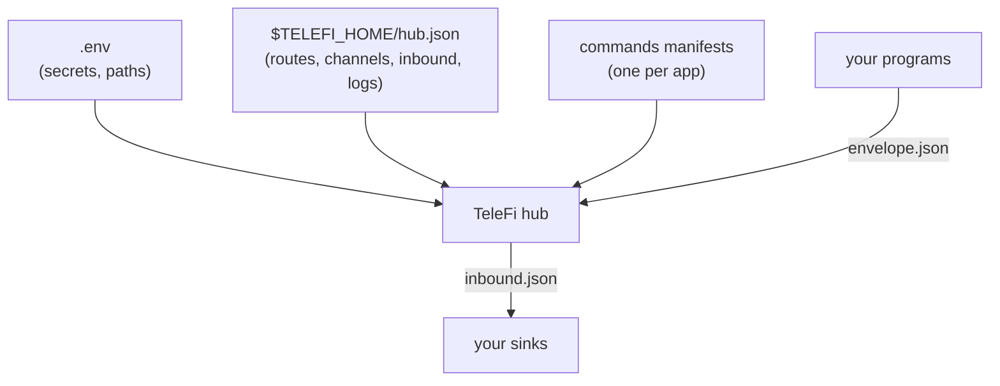

# Configuration reference

Every file below has a working template in [`examples/`](../examples) that the test suite validates
against its schema. Real configs and runtime records are git-ignored.

## Environment (`examples/.env.example`)

| variable | default | meaning |
|---|---|---|
| `TELEGRAM_BOT_TOKEN` | none | bot token from @BotFather (required for Telegram) |
| `TELEGRAM_CHAT_ID` | none | the only chat TeleFi talks to; others are ignored (required for Telegram) |
| `TELEFI_HOME` | `~/.telefi` | config, records and (by default) the spool |
| `TELEFI_SPOOL` | `$TELEFI_HOME/spool` | drop folder; overrides `spool` in `hub.json` |
| `TELEFI_LIVE` | `0` | `1` runs the live Telegram test in `pytest` |

## Hub config: `$TELEFI_HOME/hub.json` (schema `hub_config.v1`)

Templates: `examples/hub.minimal.json` (send-only) and `examples/hub.example.json` (every option).
Relative paths are relative to `TELEFI_HOME`. Without a `hub.json`, TeleFi uses built-in defaults:
errors, blockers, reviews and results go to Telegram, everything else to `bell.jsonl`; replies off.

| key | default | meaning |
|---|---|---|
| `mode` | `live` | `mock` swaps every channel for the mock (records, never sends) |
| `spool` | `spool` | drop folder |
| `dedup_window_min` | `360` | a `dedup_key` is delivered once per window (an envelope may override) |
| `logs.max_bytes` | `10485760` | a record file counts as full at this size |
| `logs.rotate_at` | `0.9` | rotate at this fraction of `max_bytes` (the safety margin) |
| `logs.keep` | `3` | rotated files kept (`name.1` ... `name.N`) |
| `channels.<name>.type` | | `telegram`, `file` or `mock` |
| `channels.<name>.token_env` / `chat_env` | `TELEGRAM_BOT_TOKEN` / `TELEGRAM_CHAT_ID` | which env vars hold the Telegram credentials |
| `channels.<name>.path` | | file channel output |
| `routes[]` | | first match wins: `match` on `source` / `kind` / `severity` lists; `{}` matches all |
| `inbound.enabled` | `false` | read replies (one hub per bot: Telegram allows one reader) |
| `inbound.channel` | `telegram` | which channel's replies to read |
| `inbound.ack_days` | `7` | an acknowledged alert stays silent this long |
| `inbound.manifests[]` | `[]` | command manifests (below); they drive `/help`, `/list` and the `/` menu |
| `inbound.commands` | `{}` | extra bare commands: word -> namespace (prefer manifests) |
| `inbound.sinks.<ns>` | `*`: queue | where a namespace's events go: `{"type":"queue"}` or `{"type":"command","argv":[...],"cwd":"...","timeout_s":60}` |

## Command manifest (schema `commands.v1`), one per app

Template: `examples/commands.example.json`. Commands are `/<app> <verb> [args]`.

| key | meaning |
|---|---|
| `app` | the command word (`[a-z0-9_]`) |
| `summary` | shown in `/help`, `/list` and the `/` menu |
| `sink` | the `inbound.sinks` entry that receives this app's commands |
| `commands[].verb` / `usage` / `summary` | one row of `/help` |
| `commands[].legacy_text` | forward `/<app> <verb> x` as `<legacy_text> x` to an older handler |

## Envelope (schema `envelope.v1`): what a program publishes

Template: `examples/envelope.example.json`. Required: `schema`, `id`, `source`, `kind`
(`failure`, `blocker`, `review`, `digest`, `result`, `info`), `severity` (`info`, `warn`, `error`,
`critical`), `title`, `created_at`. Optional: `insight` (the one-line "so what"), `body` (collapsed
details), `evidence` (`ref`, `log_path`, `links[]` -> URL buttons), `actions[]` (buttons; `input`
asks for a typed note first), `dedup_key`, `dedup_window_min`, `not_before` (hold until then).

## Inbound event (schema `inbound.v1`): what a sink receives

Template: `examples/inbound.example.json`. A `command` sink gets it on stdin and its last stdout
line is sent back as the reply (`examples/echo_sink.py`); a `queue` sink gets a file in
`spool/in/<namespace>/` (`examples/queue_drain.py`).

## Records (git-ignored, in `TELEFI_HOME`)

`outbox.jsonl` (every message + delivery result), `inbox.jsonl` (every reply + sink result),
`conversation.jsonl` (the chat both ways), `hub.log` (service starts and failed rounds),
`bell.jsonl` (the file channel). All rotate per `logs`.
