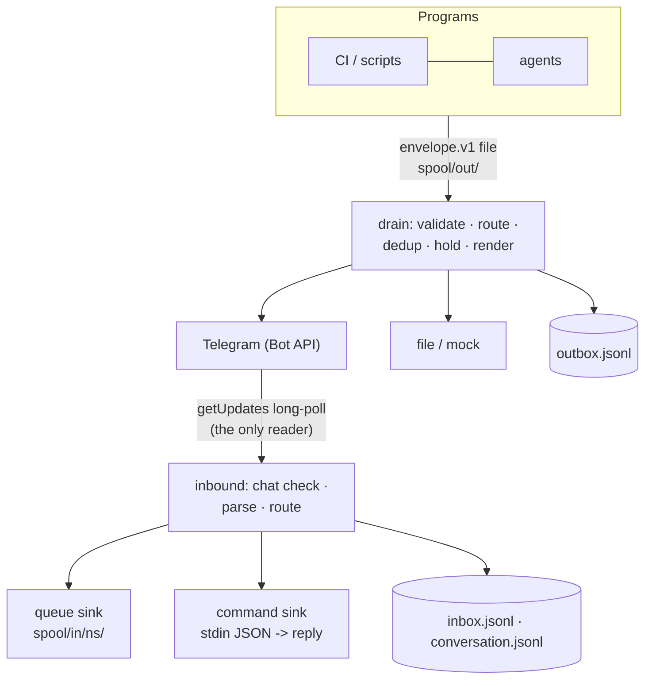

# TeleFi design

## Principles

- **Contracts, not code coupling.** Producers and consumers depend on four JSON Schemas
  (`telefi/schemas/`), never on TeleFi's Python API: `envelope.v1`, `inbound.v1`, `hub_config.v1`,
  `commands.v1`. Any language can take part.
- **Files as the transport.** A producer writes one JSON file atomically into `spool/out/`; it
  never blocks on the network and works while the hub is down.
- **One reader per bot.** Telegram hands each update to whichever process polls first, so exactly
  one TeleFi hub owns a bot's replies and routes them by namespace. Updates it does not own go
  whole to a `legacy` sink, so an existing bot keeps working behind it.
- **Glance first.** Every message renders as a headline, a one-line insight, details collapsed in
  an expandable quote, links as URL buttons and actions as callback buttons.
- **Everything recorded.** Each delivery, reply and Bot API call is a JSON line, rotated before full.
- **No dependencies.** Standard library only; the schema validator implements the JSON Schema
  subset the contracts use (`type`, `required`, `enum`, `maxLength`, `maxItems`, `properties`,
  `additionalProperties`, `items`).

## Modules

| module | role |
|---|---|
| `core.py` | config, `envelope()`, `publish()`, routing, `drain()` (dedup, holds, acks), path resolution |
| `render.py` | the message format and the callback data format (`h|ns|action|envelope`, under 64 bytes) |
| `adapters.py` | outbound channels: `TelegramAdapter`, `FileAdapter`, `MockAdapter`; the one Bot API client |
| `inbound.py` | replies: parse updates, ForceReply notes, threaded replies, acks, sinks, long-poll loop |
| `commands.py` | manifests -> `/help`, `/list`, the `/` menu, `/<app> <verb>` routing |
| `logs.py` | JSON-lines append with size-based rotation |
| `compat.py` | `TelegramChannel.send(title, body, reply_markup=...)` for simple direct sends |

## Two-way flows

| owner action | what the program receives |
|---|---|
| tap a button | `inbound.v1 {kind: action, action_id, payload}` |
| tap a button with `input` | TeleFi asks for a note (ForceReply); the reply arrives as `payload.note` |
| reply to any TeleFi message | the note goes to that message's first `input` action |
| `/<app> <verb> args` | `inbound.v1 {kind: command, command: verb, args}` to the app's sink |
| Ack | handled by TeleFi: that `dedup_key` stays silent for `ack_days` |
| `/help`, `/list` | answered by TeleFi from the manifests |

## Security model

- Only `TELEGRAM_CHAT_ID` is served; updates from any other chat are dropped and logged.
- Buttons carry an envelope id; a tap on an unknown or expired message does nothing.
- Credentials live only in the hub's environment, never in producers or envelopes.
- Callback data is not yet signed (planned).

## Platform

Developed and verified on **Windows 11** (build 26200) with **Python 3.12**. The code is
standard-library Python and should run elsewhere; Linux is untested (a systemd example is
provided).
