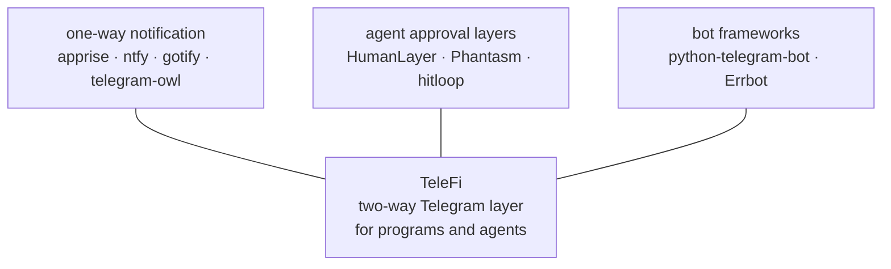

# Similar open-source projects (checked 2026-10-25)

| project | what it does | two-way | how it differs from TeleFi |
|---|---|---|---|
| [Apprise](https://github.com/caronc/apprise) | one API to 100+ notification services | no | breadth of channels, outbound only; TeleFi is Telegram-only but answers back |
| [ntfy](https://ntfy.sh) | self-hosted pub/sub push with apps, priorities, action buttons | partly (buttons call an HTTP URL) | a push server + app; TeleFi needs no server or app, uses the Telegram you have, and routes replies to your program |
| [Gotify](https://gotify.net) | self-hosted push server with web UI | no | a server to run; outbound only |
| [telegram-owl](https://kitemetric.com/blogs/telegram-owl-powerful-telegram-cli-for-notifications-ci-cd) | Go CLI to send messages and files to Telegram from scripts and CI | no | a sender CLI; no routing, records, dedup or replies |
| [HumanLayer](https://humanlayer.dev/docs) | approvals and human contact for AI agents (Slack, email, Discord) | yes | agent-SDK oriented, hosted service; no Telegram; TeleFi is local, language-neutral files |
| [Phantasm](https://dev.to/edwinkys/phantasm-a-human-approval-layer-for-ai-agents-491k), [hitloop](https://pypi.org/project/hitloop/) | open-source human-in-the-loop approval toolkits for agents (LangGraph etc.) | yes | framework integrations; TeleFi is framework-agnostic (a JSON spool) with Telegram as the surface |
| [OpenClaw Telegram approval buttons](https://awesome.ecosyste.ms/projects/github.com%2FJairFC%2Fopenclaw-telegram-approval-buttons) | one-tap Allow / Deny buttons for one agent platform | yes (approve/deny) | tied to one platform; TeleFi routes free-text notes and commands to any program |
| python-telegram-bot, Errbot | libraries / frameworks to write a bot | yes | you build the bot; TeleFi is the ready-made hub with contracts, records and a command registry |

**Where TeleFi sits:** the combination of (1) a language-neutral drop folder instead of an SDK,
(2) a consistent glance-first message format, (3) replies, typed notes and namespaced commands
delivered back to the producing program, and (4) a complete local record, with no server and no
dependencies. Closest neighbours: ntfy (push + action buttons) for the outbound half, HumanLayer for
the agent-approval half.
