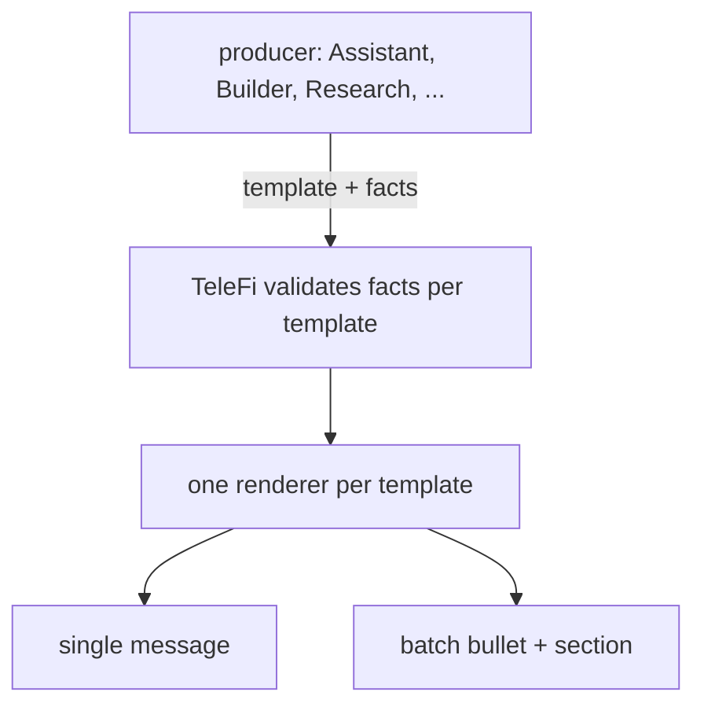

# Message catalog: one design for every TeleFi message (2026-10-28)



Canonical for message content. The visual grammar (status dot, headline, insight, collapsed details, link
buttons, action buttons) stays in `telefi/render.py`'s docstring; lanes and timing in `docs/CONFIGURATION.md`.

## Contract
- A producer sends `template` plus `facts` (a small typed object). TeleFi owns wording, emoji, order, links and
  buttons, so every producer's messages look the same. Free-text `title`/`sections` stay for unmigrated producers.
- Each template defines: **glance** (headline + one insight line, what you read without tapping), **details**
  (collapsed, at most 6 lines), **links** (URL buttons, at most 3), **actions** (callback buttons, at most 3, only
  when a sink for that action exists), and its **batch bullet** (one line, about 70 chars).
- Facts are validated per template (JSON Schema in `telefi/templates/`); unknown or missing facts reject the
  envelope with a clear error, never a half-rendered message.

## Research verdict (`research.verdict`)
One template, five outcomes; the outcome picks the dot, the insight wording and the buttons.

| outcome | dot | insight (glance line 2) | actions |
|---|---|---|---|
| PURSUE | 🟢 | `<metric> <value> [vs <benchmark> [<value>]] [<ci>]` | Start paper · Hold |
| REFINE | 🟡 | the one change to make before re-running | Re-run · Hold |
| DROP | 🔵 | the decisive number against it | Ack |
| BLOCKED | 🟡 | what is missing (data / money / access / decision) and the cheapest unblock | Unblock with note · Drop |
| NO RESULT | 🟠 | what broke (timed out / no result file / unreadable) and that Auto Fix is on it | Retry |

```
🟡 Research · #712 ACME spread study: REFINE
Edge holds only at low volume; re-run with higher costs
▸ details
  Hypothesis: the spread on ACME covers costs
  Backtest: 2019-2025 · Sharpe 0.9 vs QQQ B&H 1.1 · max DD -9%
  Paper: not started
  Source rules: transcribed (copied from the source)
  Why: edge disappears at realistic fill rate
[ Card ] [ PR #45 ] [ Result ]
[ Re-run ] [ Hold ]
```
Batch bullet: `🔬 #712 ACME spread study: REFINE, higher costs next`.
Facts: `issue, name, outcome, insight, hypothesis, backtest{metric, value required; period, benchmark, benchmark_value, ci, max_dd optional},
paper{status, days, return, benchmark_return}, source_rules, why, links{card, pr, result}`.

## Agent run (`run.receipt`, `run.failure`)
```
🟢 Assistant · Price Watch: 8 items priced, 0 alerts          🟠 Assistant · Researcher run failed
$1.72 · 6 min                                              Shell refused the input; Auto Fix filed a fix
▸ Counts: created 0 · updated 8                           ▸ Problems (up to 3) · $0.81, 1 min · log path
[ Notion ]                                                 [ Log ] [ Fix issue ]
                                                           [ Retry ] [ Ack ]
```
Never a run's free-text final message (privacy).

## Auto Fix (`fix.proposed`, `fix.merged`, `fix.diagnosis`)
| template | glance | links | actions |
|---|---|---|---|
| fix.merged (low) | 🟢 Fixed: <problem> · merged | PR | Revert |
| fix.proposed (medium) | 🟡 Fix ready: <problem> · needs your merge | PR | Merge · Hold |
| fix.diagnosis (high / not fixed) | 🟡 Can't auto-fix: <problem> | Diagnosis | Ack |

## Owner decision (`decision.ask`)
Glance: the question. Details: up to 3 options with the recommended one first and its implication.
Actions: one button per option (max 3) plus "Answer with note".

## System health (`system.down`, `system.recovered`)
TeleFi self-watch, Assistant daemon, Builder daemon: `🔴 TeleFi · Telegram unreachable since 21:50` /
`🟢 TeleFi · back after 2 h 10 min`. Links: log. Actions: Ack.

## Deal alert (`deal.alert`)
Glance: `🟢 Deal · Widget Pro $129 (-28%)`, insight: lowest in 90 days. Links: product. Actions: Snooze 7 d · Ack.

## Batch rendering
Each template's batch bullet is used as-is; its details become that item's lines inside its section; its link
buttons collapse to the first link inline. Actions are not shown in a batch (tap the bullet's link, or use the
command menu); a template with an owner action and severity `blocker` never goes to a batch.
